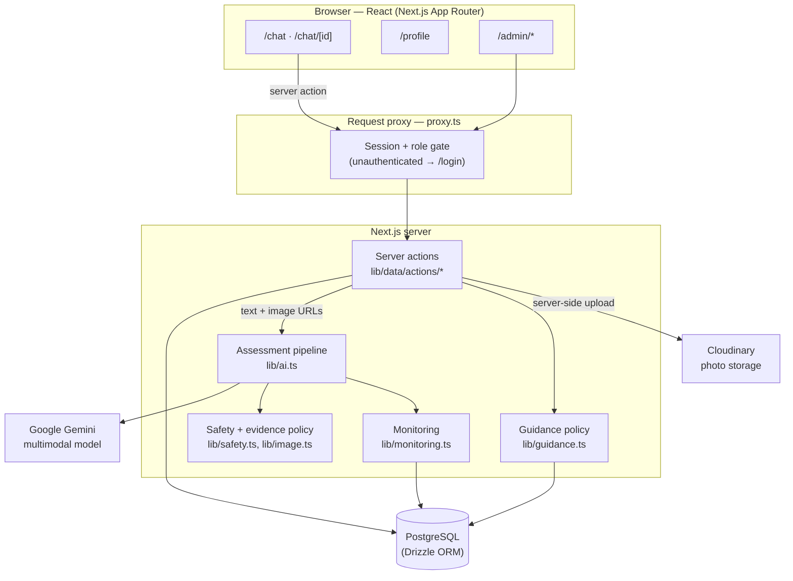
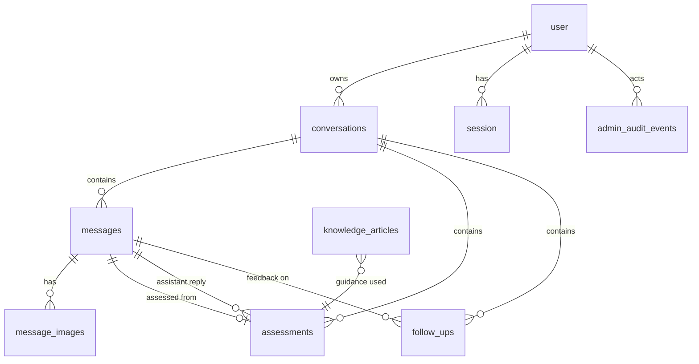

# FarmHack AI — Technical architecture

This document explains how a farmer's message becomes a cautious, structured crop assessment, and where the trust and safety boundaries sit. It complements the operational detail in [`../README.md`](../README.md) and the measured results in [`../evaluation/report.md`](../evaluation/report.md).

## Goals and constraints

- **Useful** multimodal crop guidance (text + photo) for tomato farmers in four languages.
- **Safe** by default: no unsupported pesticide/dosage advice, no definite diagnosis, escalation when evidence is thin.
- **Grounded** in traceable public guidance rather than unverifiable model memory.
- **Honest**: no claim of agricultural accuracy; everything measurable is measured, everything unknown is documented.

Nothing here is deployed or validated for real-world field use. The design targets a credible, testable prototype.

## System diagram

## Request path (a farmer sends a message)

1. **Route guard.** `proxy.ts` matches every non-API path. Unauthenticated users on `/chat` or `/admin` are redirected to `/login`; roles are checked and unknown roles are signed out. The route-group layouts (`app/(farmer)/layout.tsx`, `app/admin/layout.tsx`) repeat the check server-side.
2. **Server action.** The client calls a server action (for example `createMessage`, `runAssessment`, `uploadCropImage`). Inputs are validated with Zod. The acting user comes from the Better Auth session, never from client input.
3. **Ownership scoping.** Every conversation, message, assessment, and follow-up query is filtered by `conversations.userId = session.user.id`, so one farmer cannot read or mutate another's data. Admin-only actions call `getCurrentAdmin()`, which throws unless `role === "admin"`.
4. **Photo upload.** `uploadCropImage` validates MIME type and size, then verifies the **file signature** (`looksLikeImage`) so a renamed non-image cannot reach Cloudinary. It confirms conversation ownership and that the target message belongs to that conversation *before* uploading, so a failed access check cannot leave an orphaned file. If binding the upload to the database fails, the Cloudinary asset is deleted.
5. **Evidence assembly.** Text and image URLs are read from the stored message and its attachments, not from the request body. Unreachable or unusable images are dropped and counted.
6. **Model call.** `assessCropHealth` builds a prompt that includes the crop-scoped guidance block, sends the text and inline images to Gemini, and requests a JSON object matching the assessment schema. If the primary model is overloaded or out of quota, `GEMINI_FALLBACK_MODELS` are tried in order.
7. **Validation.** The response is parsed with Zod. On failure, one repair attempt is made with the validation errors attached; if that also fails, the request fails closed to a safe fallback and is recorded as `validation_outcome = invalid`, `outcome = fallback`.
8. **Safety audit.** `lib/safety.ts` removes or refuses restricted content (pesticide names, dosages, definite-diagnosis language) in all four languages, forcing escalation where required. The post-filter output is audited again so the filter cannot reintroduce unsafe text.
9. **Evidence policy.** `applyEvidencePolicy` enforces the no-evidence rules: no text and no image → safe fallback; no findings → high uncertainty plus escalation; empty follow-up list → a clarifying question is added.
10. **Persistence and monitoring.** The assessment is stored against the message (one assessment per message) with the model and `PROMPT_VERSION`. An `ai_events` row records model, prompt version, validation outcome, fallback/error state, latency, image-failure count, and safety-flag count. Telemetry is best-effort and outside the assessment transaction, so it can never block a farmer.
11. **Rendering.** The client renders the structured assessment card: observed signs, possible causes, questions to check, suggested actions, when to seek help, uncertainty, and a limitations notice. The farmer can submit outcome feedback.

## Data model

- `user`, `session`, `account`, `verification` — Better Auth.
- `conversations` — owner, title, crop, language.
- `messages` — role (`user`/`assistant`), content, language.
- `message_images` — Cloudinary `public_id` and secure URL, linked to a message.
- `assessments` — structured result JSON, model, prompt version, and the source/assistant message ids. A unique constraint allows one assessment per source message.
- `follow_ups` — farmer outcome feedback (`outcome`, `helpful`, free-text observation).
- `knowledge_articles` — guidance with provenance (`source_backed` / `expert_reviewed`) and source metadata.
- `ai_events` — privacy-conscious telemetry (no farmer text, prompts, model output, or image URLs).
- `admin_audit_events` — admin actions.

Deletions cascade: removing a conversation removes its messages, assessments, and follow-ups; removing a message removes its images; Cloudinary media is deleted before database rows.

## Trust boundaries

| Boundary | Trusted side | What crosses it |
| --- | --- | --- |
| Browser → server | Server | Text, a file upload, and ids. Evidence for the model is re-derived server-side. |
| Server → Gemini | Server | Crop text, inline image data, guidance snippets. Provider errors stay in the server log. |
| Server → Cloudinary | Server | Image bytes; secrets never leave the server. |
| Admin UI → server | Server | Every admin action re-checks the admin role. |

## Known gaps

- Public guidance URLs are given to the model but are not yet rendered as citations in the farmer UI.
- Guided symptom collection is limited to the model's follow-up questions; there is no dedicated intake wizard.
- No scheduled follow-up reminders.
- Mobile performance is designed for but not benchmarked on low-end devices.

See [`../evaluation/report.md`](../evaluation/report.md) for the evaluation design and [`validation-plan.md`](./validation-plan.md) for the route to real-world validation.
